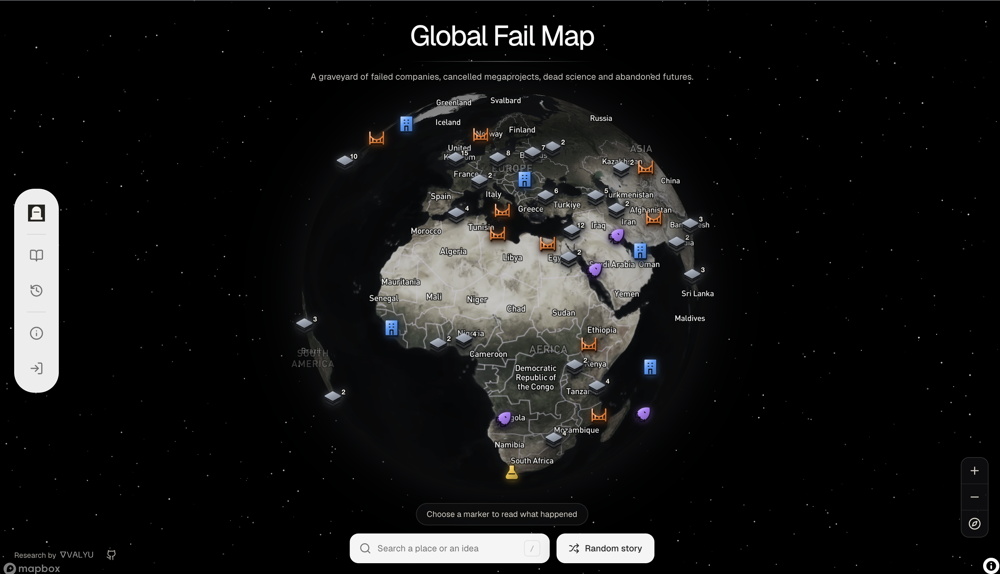

# Global Fail Map

An interactive atlas of failed companies, cancelled megaprojects, abandoned inventions, terminated experiments, and futures that never arrived. Global Fail Map turns researched failure into a browsable world map: every marker opens a sourced story about what people tried to build, why it ended, what survived, and what the next builder can learn.



Explore 200 curated stories about what was attempted, where it happened, and what survived after it ended.

<p align="center">
  
  
  
</p>

Global Fail Map is part graveyard, part research tool, and part strategy reference. It maps the evidence left behind by ambition: empty terminals, dissolved companies, shelved reactors, withdrawn drugs, ghost infrastructure, dead platforms, and plans that were too early, too expensive, too political, or simply wrong.

## Features

### Interactive Atlas

- **Globe-first map** - Explore failure across continents through a Mapbox globe with custom category symbols.
- **200 bundled stories** - Browse a curated atlas of documented attempts across infrastructure, companies, science, technology, and speculative visions.
- **Dense-marker handling** - Nearby stories group cleanly without losing individual reports.
- **Random discovery** - Jump to a random story when you want serendipity instead of search.
- **Responsive reading** - Open long-form reports without leaving the map context.

### Researched Failure Reports

- **Cited Markdown reports** - Every bundled story links to a source-backed report under `public/reports`.
- **Clear failure anatomy** - Reports separate the plan, location, timeline, ending, uncertainty, and afterlife.
- **Numbered citation integrity** - Cached reports keep numbered citations aligned with the source list in `src/data/examples.json`.
- **Source metadata** - Each atlas entry preserves source URLs, research mode, task ID, confidence, coordinates, category, period, and status.

### Live Deep Research

- **Research any place or idea** - Click the map or search a subject to launch a Valyu DeepResearch investigation.
- **Effort controls** - Low, Medium, and High research settings map to Fast, Standard, and Heavy modes.
- **Progress activity** - Research progress surfaces meaningful provider steps instead of invented percentages.
- **Public sharing** - Publish a completed report to create a revocable public `/?share=<id>` link.
- **Completion notifications** - Hosted or configured self-hosted installs can send report-ready emails through Valyu.

### Discovery And Evidence

- **Project photos** - The app discovers bounded public images through Valyu search results and keeps source attribution.
- **Nigeria archive links** - Nigerian reports can link readers into archivi.ng with period-aware search windows.
- **Map-aware research prompts** - Location research preserves the selected geographic scope and does not invent anchors for worldwide ideas.
- **Safe public reads** - Shared reports expose only explicitly published, sanitized report fields and source URLs.

### Curation Pipeline

- **Batch curation files** - Regional files in `scripts/curated` hold the human-written title, subtitle, summary, lesson, category, and corrected coordinates.
- **Isolated validation** - `scripts/check-curated.ts` checks one curated batch without rewriting shared outputs.
- **Draft generation** - `scripts/build-entries.ts` converts curated entries into atlas records and Markdown reports.
- **Safe publishing** - `scripts/merge-entries.ts` folds the generated draft into `src/data/examples.json` and refuses thin, malformed, or source-less entries.

## Why This Exists

Success stories compress history into inevitability. Failure keeps the forks visible.

Fordlandia, the N-1 lunar rocket, the Superconducting Super Collider, Project Cybersyn, Monju, Concorde, Renren, Juicero, Biosphere 2, Byju's, the Hopewell Project, and the Ryugyong Hotel did not simply vanish. They left behind infrastructure, court rulings, technical knowledge, market warnings, successor institutions, scar tissue, and sometimes better versions built by someone else.

Global Fail Map treats failure as evidence, not trivia. Each story asks:

- What was actually attempted?
- Why did it matter at the time?
- Where did it physically, legally, or institutionally happen?
- What broke: financing, demand, politics, safety, execution, timing, or trust?
- What survived after the project, product, company, or experiment ended?
- What should a future builder learn before trying again?

## Tech Stack

- **Framework**: Next.js 16 with App Router
- **UI**: React 19, Tailwind CSS, custom components
- **Map**: Mapbox GL JS with globe projection
- **Research**: Valyu DeepResearch API
- **Auth**: Valyu OAuth 2.1 with PKCE in hosted mode
- **State**: Zustand
- **Markdown**: react-markdown and remark-gfm
- **Validation**: zod and Node test runner
- **Analytics**: Vercel Analytics

## Getting Started

### Prerequisites

- Node.js 22+
- pnpm 10+
- Mapbox public token
- Valyu API key

### Installation

1. Clone the repository and install dependencies:

```bash
git clone https://github.com/yorkeccak/global-fail-map.git
cd global-fail-map
pnpm install
```

2. Create your local environment file:

```bash
cp .env.example .env.local
```

3. Configure self-hosted mode:

```env
NEXT_PUBLIC_APP_MODE=self-hosted
NEXT_PUBLIC_APP_URL=http://localhost:3000
NEXT_PUBLIC_MAPBOX_ACCESS_TOKEN=pk_your_public_token
VALYU_API_KEY=valyu_your_api_key
```

4. Run the development server:

```bash
pnpm dev
```

5. Open [http://localhost:3000](http://localhost:3000).

## App Modes

### Self-Hosted Mode

Self-hosted mode uses your server-side `VALYU_API_KEY` and does not require a database.

```env
NEXT_PUBLIC_APP_MODE=self-hosted
VALYU_API_KEY=valyu_your_api_key
```

Research history is read from `GET /v1/deepresearch/list` for that key. Optionally set `DEEPRESEARCH_ALERT_EMAIL` to an email in your Valyu organization and set `NEXT_PUBLIC_APP_URL` to the reachable app URL so completion emails point back to the correct report.

### Hosted Valyu Mode

Hosted mode lets users sign in with Valyu. OAuth tokens stay in encrypted HTTP-only cookies, and research requests pass through the Valyu OAuth proxy.

```env
NEXT_PUBLIC_APP_MODE=valyu
NEXT_PUBLIC_APP_URL=https://your-app.example
NEXT_PUBLIC_MAPBOX_ACCESS_TOKEN=pk_your_public_token
NEXT_PUBLIC_VALYU_AUTH_URL=https://your-auth-host.example
NEXT_PUBLIC_VALYU_CLIENT_ID=your_client_id
VALYU_CLIENT_SECRET=your_client_secret
VALYU_SESSION_SECRET=at_least_32_random_characters
VALYU_APP_URL=https://platform.valyu.ai
```

Allow `https://your-app.example/auth/valyu/callback` in the OAuth client.

## Using The Atlas

### Browse Bundled Stories

- Click any marker to open the story panel.
- Use filters to focus on companies, infrastructure, science, technology, or visions.
- Use random story mode to jump through the archive.
- Open the full report to inspect citations and source links.

### Research A New Subject

- Search for a place, project, company, or idea.
- Choose research effort in Advanced settings when needed.
- Wait for the report to complete or reopen it later with `/?research=<id>`.
- Publish the report only when you want a public `/?share=<id>` link.

### Refresh Bundled Reports

The bundled reports are cached Markdown files. Their task IDs and source metadata live in `src/data/examples.json`.

```bash
pnpm sync:examples
```

This command requires a configured Valyu CLI session. It fails if any task is incomplete instead of publishing partial output. Cached reports may contain hand-reviewed factual corrections, so review the diff before replacing them.

## Curation Workflow

Curated entries live in regional JSON files under `scripts/curated`.

Validate one batch:

```bash
npx tsx scripts/check-curated.ts scripts/curated/africa.json
```

Build generated draft entries and reports:

```bash
npx tsx scripts/build-entries.ts
```

Merge the generated draft into the atlas:

```bash
npx tsx scripts/merge-entries.ts
```

The merge step protects the published atlas from duplicate IDs, repeated subtitles, colon titles, missing coordinates, thin lessons, and missing sources.

## Project Structure

```text
global-fail-map/
├── public/
│   ├── global-fail-map.png        # README screenshot
│   └── reports/                   # Cached Markdown reports
├── scripts/
│   ├── curated/                   # Regional curated story batches
│   ├── build-entries.ts           # Generates draft entries and reports
│   ├── check-curated.ts           # Validates one curated batch
│   ├── merge-entries.ts           # Publishes generated entries to the atlas
│   └── sync-example-reports.mjs   # Refreshes reports from Valyu tasks
├── src/
│   ├── app/                       # Next.js routes and API endpoints
│   ├── components/auth/           # Valyu auth UI
│   ├── components/fail-map/       # Globe, dock, markers, reports, legend
│   ├── components/ui/             # Shared UI primitives
│   ├── data/examples.json         # Published atlas entries
│   └── lib/                       # Types, stores, auth, archiving, utilities
└── tests/                         # Node test runner coverage
```

## API Routes

| Route | Method | Description |
| --- | --- | --- |
| `/api/investigations` | `POST` | Create a Valyu DeepResearch task |
| `/api/investigations` | `GET` | List authenticated research tasks |
| `/api/investigations/[id]` | `GET` | Poll a task or read a completed report |
| `/api/investigations/[id]` | `PATCH` | Publish or revoke a shared report |
| `/api/auth/valyu/start` | `GET` | Start OAuth sign-in with PKCE |
| `/api/auth/valyu/session` | `GET/DELETE` | Read or clear the hosted auth session |

## Checks

```bash
pnpm lint
pnpm typecheck
pnpm test
pnpm build
```

## License

MIT. See [LICENSE](LICENSE).
